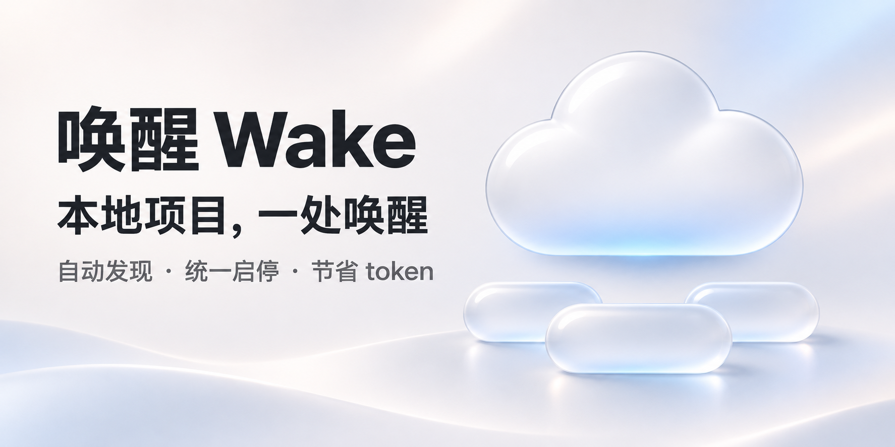
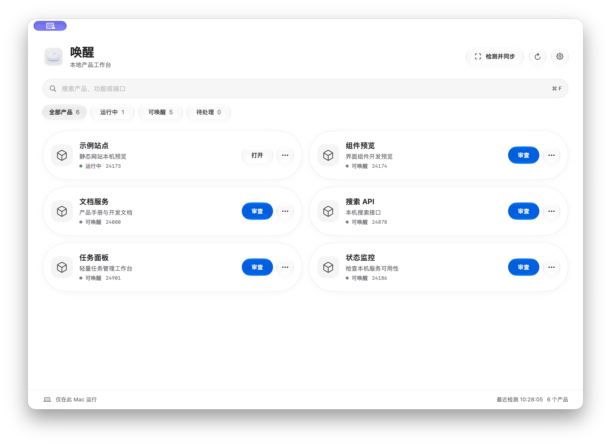
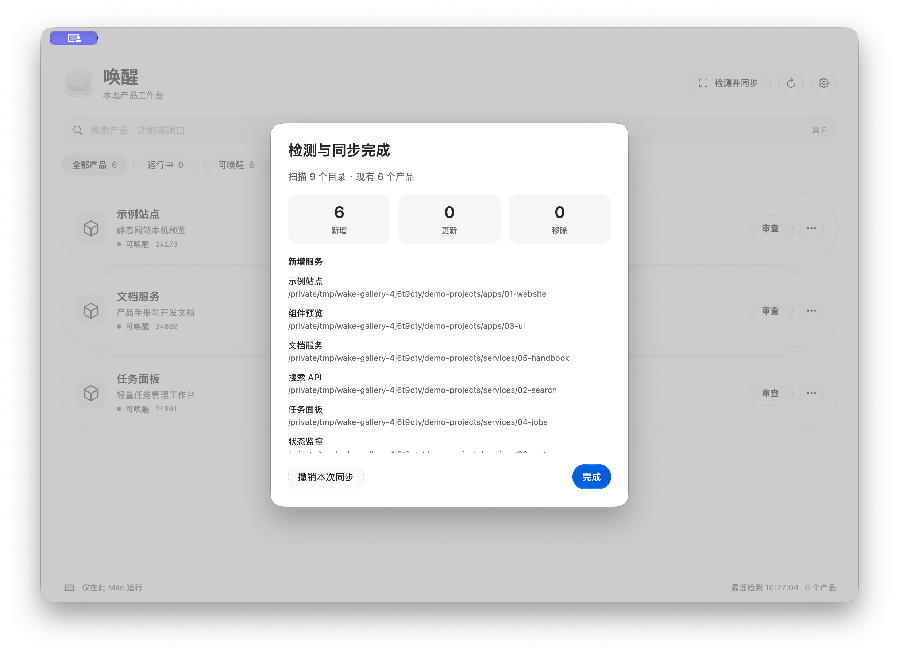

# Wake · 唤醒

A macOS workbench for self-hosted projects. Scan a product folder for runnable projects and manage their status, ports, and startup from one interface.

**1.0 source release** · MIT · Apple Silicon



## Highlights

1. **Discover projects across a product folder.** Pick a root folder and run a recursive scan for supported Node.js, Python, Docker Compose, startup scripts, and explicit manifests. Sync adds or updates the project cards it discovers.
2. **Start and manage projects in one place.** Review each project's launch command before its first launch, then use its card to start it, open its local page, check its ports and logs, or stop a verified process. Routine operations take a click.
3. **Spend fewer AI tokens on routine operations.** Discovery, status checks, and service controls run locally without model calls. Use AI for the work that needs it, such as investigating a bug or reviewing code.

## Screenshots

Wake 1.0 running with synthetic projects.





## Features

- Native SwiftUI / AppKit interface with capsule cards; Liquid Glass on macOS 26.
- User-selected scan folders; empty initial inventory.
- Discovery for supported Node, Python, Compose and explicit manifest deployments.
- First-start entry review, persistent configuration-bound trust, local logs and reversible inventory sync.
- Port ownership checks and opt-in port remapping; no blanket rewrite of deployment files.
- Detached service processes survive exiting Wake. Stop is available only for verified owned processes.
- Private-pipe control engine; no extra local HTTP control server or cloud account.

Scans follow the selected folder scope, supported launch formats, and depth and time limits. Prepare dependencies according to each project's own instructions.

## Build

The current package targets **Apple Silicon only**. Minimum deployment target is macOS 14; building requires the macOS 26 SDK and Swift 6.2 or newer through Xcode / Command Line Tools. Older supported macOS releases use a visual fallback and still need separate runtime acceptance.

Install the build-only `zstd` tool, then:

```sh
brew install zstd
./script/build_and_run.sh --build-only
```

The first build downloads pinned official Python assets and verifies their SHA-256 hashes. Build outputs are `dist/Wake-1.0-macos-arm64.zip` and `dist/SHA256SUMS.txt`. Build caches stay in `.build-native/`.

The default signature is ad hoc, intended for local testing. This is not a notarized public binary. `--install` explicitly installs the generated bundle to `/Applications/唤醒.app`; `run` installs and opens it. A different existing app identity is never overwritten automatically.

## First use

1. Choose the folder containing your own local products.
2. Run detection and synchronization.
3. Review a discovered product's entry before its first launch.

Use `examples/demo-service` for a synthetic local test. It requires `python3` on the machine and contains no credentials or personal data. See [configuration](docs/configuration.md), [build details](docs/build.md), [privacy](PRIVACY.md), and [contributing](CONTRIBUTING.md).

MIT license for original source and the project cloud icon. Bundled runtime notices are preserved separately; see [third-party notices](THIRD_PARTY_NOTICES.md). 中文说明见 [README](README.md).
