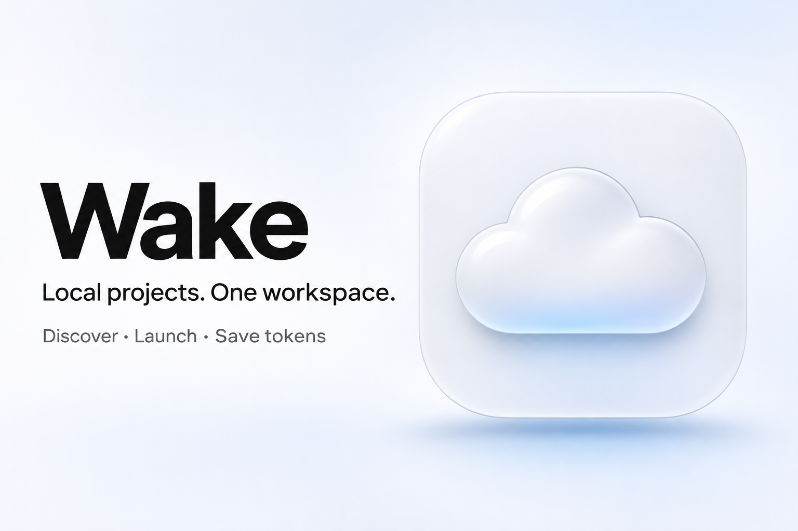
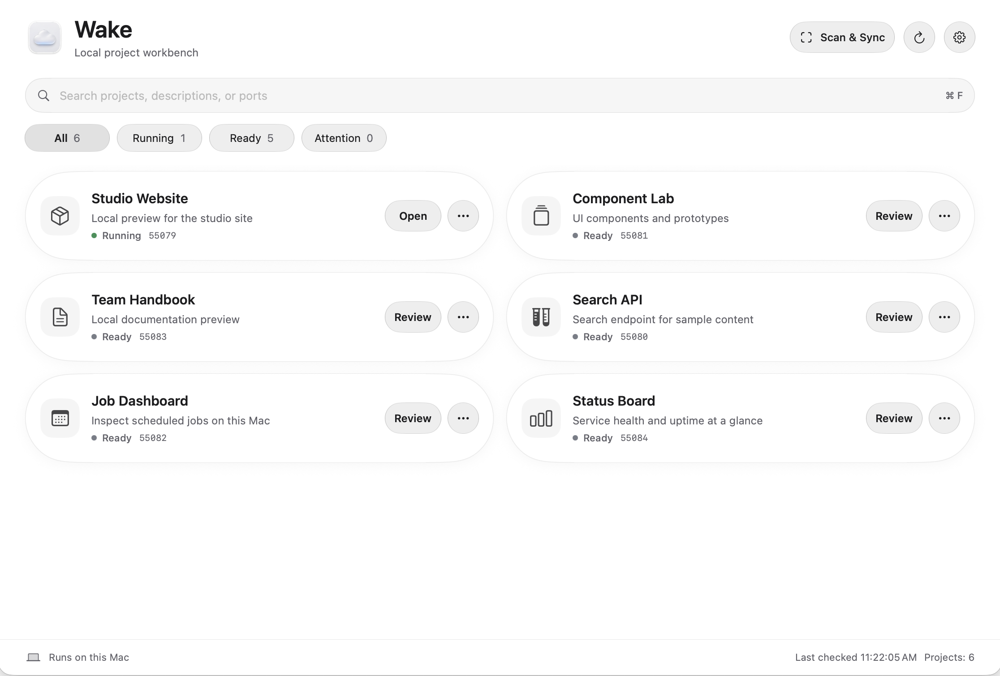
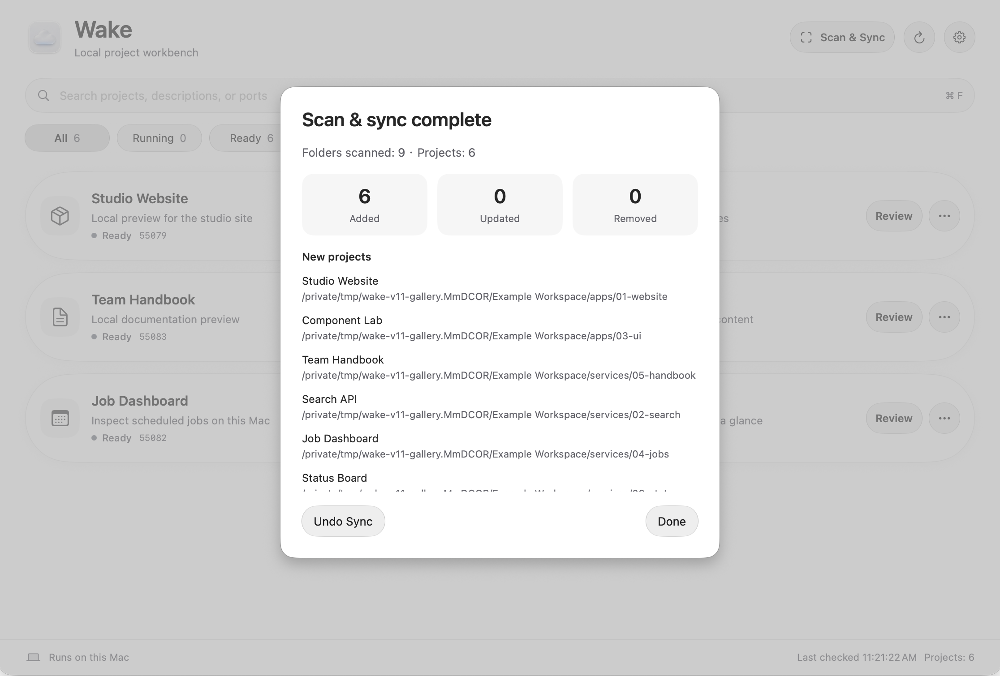

# Wake · 唤醒

**Local projects. One workspace.** Wake is an open-source macOS app that discovers and manages self-hosted projects from a single workbench.

[中文说明](README.zh-CN.md) · [Wake 1.1 release](https://github.com/louisfy/wake/releases/tag/v1.1) · [Configuration](docs/configuration.md) · [Build](docs/build.md) · [Privacy](PRIVACY.md) · [Contribute](CONTRIBUTING.md)

## Why Wake?

1. **Discover projects across a folder tree.** Choose a product or workspace folder. Wake scans its subfolders for supported Node.js, Python, Docker Compose, startup scripts, and explicit manifests. Scan & Sync adds, updates, or removes the corresponding cards as deployments change.
2. **Start and manage everything from one place.** See deployment status, running services, ports, and launch logs. Review a project's command once, then start it, open its local page, or stop a verified process from its card.
3. **Save AI tokens for work that needs AI.** Scans, status checks, and service controls run on your Mac without model calls. Routine launches take a click instead of a terminal command or a prompt to an AI assistant.

## Screenshots

Wake 1.1 with synthetic local projects. English is the default. Switch to 简体中文 in **Settings → Language**; changes apply immediately, including status messages. Running services keep running.

## What it does

- Native SwiftUI and AppKit workbench with capsule cards and system Liquid Glass on macOS 26 or later.
- First-launch command review and saved trust tied to the launch configuration.
- Port conflict checks and alternate ports for supported launch types.
- Reversible inventory sync; removing cards does not delete project files.
- Services keep running when you quit Wake. Stop is available when Wake can verify the process it started.
- Local logs and a private control pipe. Wake requires no account, model API key, or separate HTTP control server.

Scanning is limited to selected folders, supported launch formats, and depth and time limits. Install project dependencies using each project's own instructions.

## Build and try it

**Apple Silicon** · macOS 14 minimum deployment target · Build with the macOS 26 SDK and Swift 6.2 or newer. The UI has a visual fallback for older systems; those systems require separate runtime testing.

Install the build tool and run:

~~~sh
brew install zstd
./script/build_and_run.sh --build-only
~~~

The first build downloads pinned public Python assets and verifies their SHA-256 hashes. The output is **dist/Wake-1.1-macos-arm64.zip** with checksums in **dist/SHA256SUMS.txt**. The GitHub release provides source. The locally built app uses an ad hoc signature for testing and has not been notarized.

1. Double-click **Preview.command** after building. It runs a temporary app with preview data under **.local/preview-data/**.
2. Choose a folder with projects, or choose **examples/demo-service** to try the bundled sample.
3. Click **Scan & Sync**, then **Review** on the sample card. If you trust the example command, click **Trust & Start**.

The sample needs **python3** and listens on localhost. To install the app instead, see the [build guide](docs/build.md). Your scan folders, inventory, trust records, and logs stay on this Mac. Read [Privacy](PRIVACY.md) before sharing diagnostics.

Wake's original source and cloud icon are [MIT licensed](LICENSE). Runtime dependencies retain their own [notices](THIRD_PARTY_NOTICES.md).
