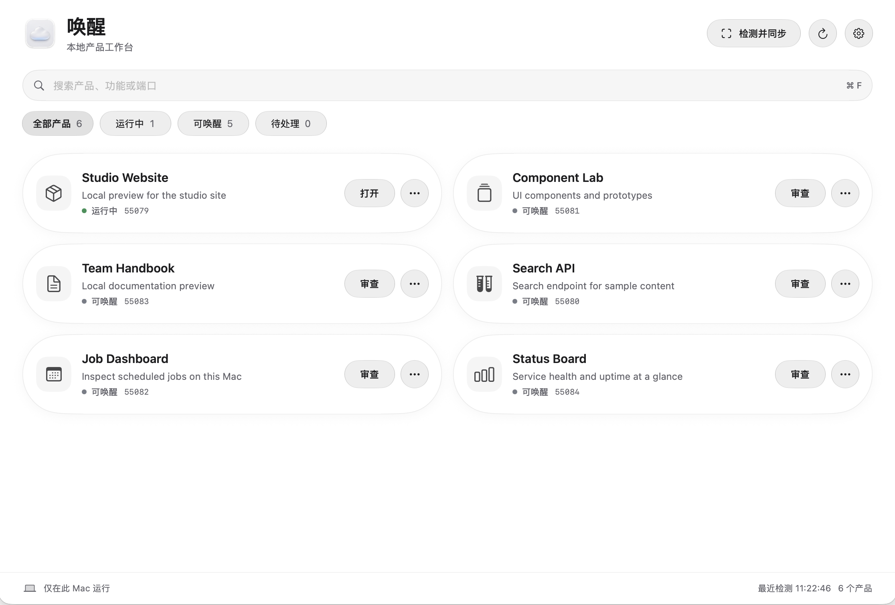
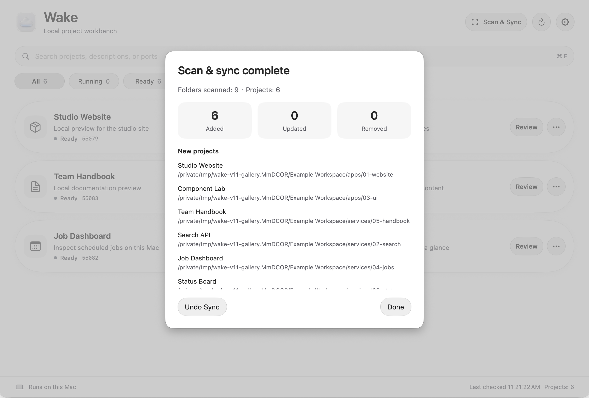

# 唤醒 · Wake

**本地项目，一处唤醒。** 唤醒是面向自部署服务的 macOS 工作台。选中产品目录后，它会发现可启动的工程，把运行状态、端口和启停操作集中到卡片上。


**1.1 源码发布** · MIT · Apple Silicon

[English](README.md) · [使用配置](docs/zh-CN/configuration.md) · [构建](docs/zh-CN/build.md) · [隐私](docs/zh-CN/PRIVACY.md) · [参与贡献](docs/zh-CN/CONTRIBUTING.md)

## 三个亮点

1. **从整个产品目录发现工程。** 选择产品根目录后，点击「检测同步」，递归识别子目录中带有受支持启动入口的工程，包括 Node.js、Python、Docker Compose、启动脚本与显式清单。扫描会跳过依赖、文档和构建产物目录，也可同步新增或移除的项目卡片。
2. **在一个工作台启动和管理。** 查看各项目的部署状态、运行状态、端口和日志。首次审查启动命令后，可从卡片唤醒服务、打开本机页面，并停止归属已核验的进程。日常操作从工作台完成，省去重复输入命令或请 AI 代操作。
3. **减少日常操作的 token 消耗。** 扫描、状态检查、端口检查和启停由本地程序完成，这些操作无需调用模型。需要 AI 分析代码或排查问题时，再把 token 用在对应任务上。

## 界面预览

以下为 1.1 使用合成工程的实机截图。默认使用英文，可在「Settings → Language」选择「简体中文」。切换立即生效，已运行的服务继续运行。

**统一工作台**



**从一个目录发现多个工程（英文界面）**



## 更多能力

- 原生 SwiftUI / AppKit 界面，白色背景、统一胶囊卡片；macOS 26 使用系统液态玻璃。
- 查看依赖文件、进程归属、服务响应和端口冲突；支持的启动方式可自动避让占用端口。
- 检测同步增删改卡片，并可撤销最近一次同步；不会删除项目文件。
- 首次启动前审查命令并确认信任，启动日志仅保存在本机。
- 已启动的服务独立运行，退出唤醒后继续工作；只有核验归属的进程才提供停止操作。
- 控制引擎使用私有管道，无需另开一个本机网页服务，无需云端账户。

扫描限于用户选择的范围，并遵循层数、目录数和时间上限。请按项目自身的说明准备依赖和运行环境。

## 系统与构建

本版本提供源码。当前构建面向 **Apple Silicon / arm64**，最低部署目标为 macOS 14。构建需要包含 macOS 26 SDK 的 Xcode / Command Line Tools 和 Swift 6.2 或以上。较旧系统使用普通圆角材质，实际兼容性仍需单独验证。

安装仅构建时使用的解压工具后执行：

```sh
brew install zstd
./script/build_and_run.sh --build-only
```

首次构建从官方固定地址获取 Python 3.12.16，验证 SHA-256 后使用；不依赖其他已安装产品。产物为：

```text
dist/Wake-1.1-macos-arm64.zip
dist/SHA256SUMS.txt
```

默认只构建，不安装。默认 ad hoc 签名用于本机测试，不代表已通过 Apple 公证。`--install` 显式安装到 `/Applications/Wake.app`；`run` 安装并打开。已有同标识的 1.0 安装将原位升级；标识不同的应用不会被覆盖。

构建后可双击 `Preview.command`。它使用项目 `.local/preview-data/` 保存独立体验数据，在临时目录运行应用，退出后清理临时应用。已唤醒的服务继续独立运行。

## 第一次打开

1. 选择本地产品所在的文件夹。
2. 点击「检测同步」发现产品。
3. 首次点击卡片时，在详情中审查启动入口，确认信任后唤醒。

可先选择 `examples/demo-service` 体验合成服务，电脑需有可用的 `python3`。示例页面内可以切换中英文。示例只监听本机，使用端口 61935，未包含个人产品或凭据。

开源版默认数据目录为 `~/Library/Application Support/Wake/`，与历史个人版本隔离，不自动导入个人清单。扫描范围、配置和日志均为本机数据，勿直接上传至公开 Issue。

## 开发与发布材料

```sh
python3 -B script/fetch_runtime.py
# 使用上一步输出目录中的 bin/python3.12 执行测试
python3.12 -B -m unittest discover -s Tests -q
python3 -B script/privacy_check.py --source
python3 -B script/prepare_source.py
```

源码导出按明确的文件范围生成 `dist/Wake-1.1-source.zip`。检查器覆盖已定义的敏感模式，公开前还需审查实际内容。

仓库包含 CI、Issue / PR 模板、[1.1 发布说明](docs/zh-CN/github-release.md)及[本地验收清单](docs/zh-CN/acceptance.md)。

## 许可证

原创源码和云朵图标采用 [MIT](LICENSE)。Python 及其依赖保留各自许可证，见 [第三方声明](THIRD_PARTY_NOTICES.md)。
