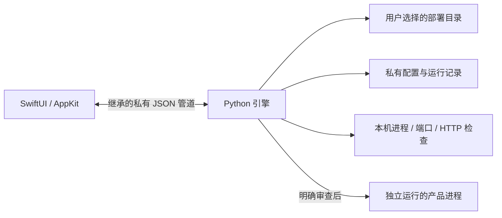

# 架构

`WakeApp` 管理单实例和窗口；`WakeStore` 管理界面快照、刷新与操作状态。`ServiceBridge` 负责子进程、管道帧解析、请求超时与断线恢复。没有可供局域网调用的控制 HTTP 服务。

`discovery.py` 只读取支持的本地部署描述并生成卡片；不会执行项目启动脚本。`Manager` 负责校验清单、状态检测、配置备份、端口规划及启动信任。项目依赖探测在明确启动后执行，不在轮询中执行。

启动任务使用跨进程锁和持久化记录，避免退出重开时重复启动；服务通过新的进程会话独立运行。唤醒退出会关闭管道，让已接受的启动任务收尾，不强制结束产品服务。

停止操作验证记录中的 PID、命令指纹和进程创建时间，避免 PID 重用时结束其他进程。复杂多进程产品未必能由直接 PID 停止，界面按实际归属能力提供操作。

同步配置使用独立锁、原子写入和有限备份，撤销前核对同步后清单摘要，保留后来发生的用户修改。

语言偏好保存在应用设置中。界面在每次管道请求中发送当前语言，后端按请求生成状态和提示，切换语言不会重启引擎或修改项目清单。
